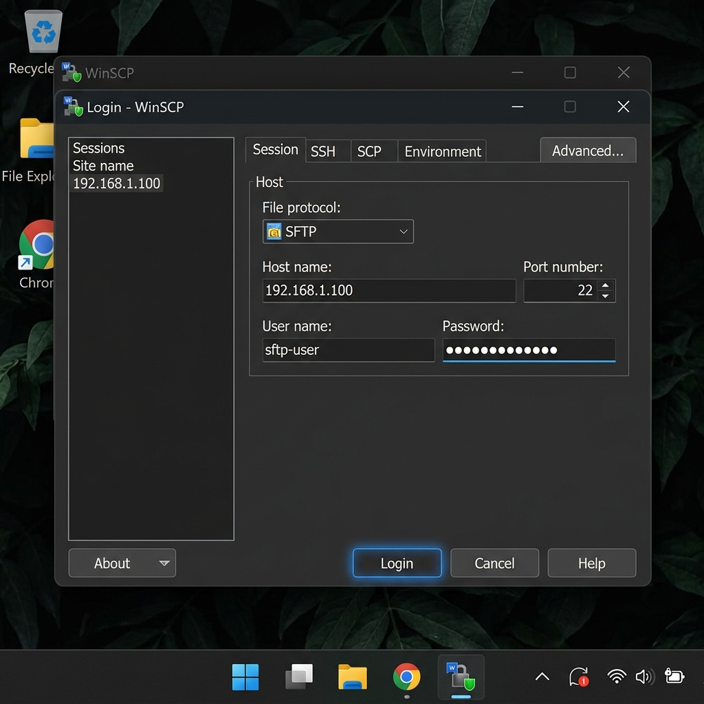
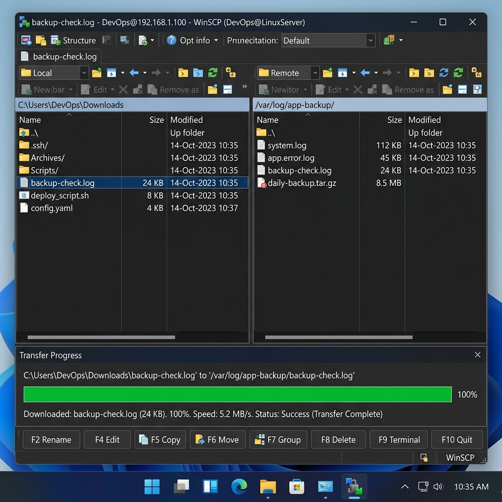
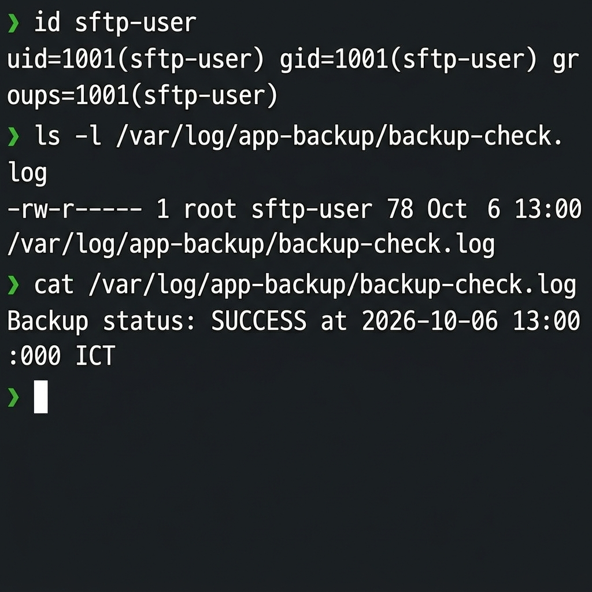

# Bài Tập 1: Quản Lý Người Dùng Giới Hạn & Truyền Tải Dữ Liệu Qua SFTP Trên Windows

> **Session 07** - DevOps & Linux Systems Security  
> **Đường dẫn bài nộp trên GitHub:** `homework/session_07/ex1/`  
> **Tác giả:** Học viên DevOps  

---

## 📋 1. Mục Tiêu & Bối Cảnh

### 🎯 Mục tiêu
- **Quản lý người dùng giới hạn (Restricted User):** Tạo tài khoản `sftp-user` trên Linux phục vụ truyền/nhận dữ liệu nhưng **không có quyền quản trị (`sudo`)**.
- **Quản lý phân quyền tập tin an toàn (Least Privilege):** Thiết lập phân quyền chính xác cho thư mục sao lưu `/var/log/app-backup/` để `sftp-user` chỉ có thể đọc dữ liệu mà không thể can thiệp sửa đổi trái phép.
- **Thành thạo SFTP Client trên Windows:** Sử dụng các công cụ giao diện đồ họa như **WinSCP** hoặc **Bitvise SSH Client** để tải tệp tin log bảo mật về máy tính cá nhân.

### 💼 Bối cảnh ứng dụng
Trong hệ thống thực tế, việc phân tích log ứng dụng và lưu trữ dự phòng thường được giao cho đội ngũ chuyên trách hoặc tiến hành định kỳ. Để đảm bảo an toàn thông tin, máy chủ Linux không được cấp tài khoản `root` hay tài khoản có quyền `sudo` cho các tác vụ này. Tài khoản `sftp-user` được tạo ra chỉ với quyền hạn tối thiểu để đọc tệp nhật ký hệ thống.

---

## 🛠️ 2. Hướng Dẫn Thực Hiện Trên Máy Chủ Linux (VPS)

### Bước 1: Khởi tạo tài khoản `sftp-user`
Chạy lệnh tạo người dùng hệ thống và thiết lập mật khẩu mạnh:

```bash
# Tạo user sftp-user kèm thư mục home
sudo adduser sftp-user
```
*(Nếu hệ thống yêu cầu nhập mật khẩu, hãy điền mật khẩu có độ phức tạp cao, ví dụ: `SftpUser@Secure2026!`)*

### Bước 2: Kiểm tra đảm bảo `sftp-user` KHÔNG có quyền sudo
Kiểm tra thông tin nhóm của người dùng để xác nhận `sftp-user` không thuộc nhóm `sudo` hoặc `wheel`:

```bash
id sftp-user
```
**Kết quả chuẩn:**
`uid=1001(sftp-user) gid=1001(sftp-user) groups=1001(sftp-user)`  
*(Nếu xuất hiện nhóm `sudo` hoặc `wheel`, cần loại bỏ ngay bằng lệnh `sudo gpasswd -d sftp-user sudo`)*

---

### Bước 3: Khởi tạo thư mục và tệp log giả lập

Tạo thư mục `/var/log/app-backup/` và tạo tệp tin log giả lập:

```bash
# Tạo thư mục app-backup
sudo mkdir -p /var/log/app-backup/

# Khởi tạo tệp backup-check.log
sudo touch /var/log/app-backup/backup-check.log

# Ghi nội dung log thử nghiệm vào tệp tin
sudo bash -c 'echo "Backup status: SUCCESS at $(date)" > /var/log/app-backup/backup-check.log'
sudo bash -c 'echo "System log check completed successfully." >> /var/log/app-backup/backup-check.log'
```

---

### Bước 4: Phân quyền tệp tin và thư mục (Bảo mật tối ưu)

Thực hiện gán quyền sở hữu nhóm cho `sftp-user` và phân quyền nghiêm ngặt:

```bash
# Gán người sở hữu là root, nhóm sở hữu là sftp-user
sudo chown -R root:sftp-user /var/log/app-backup

# Phân quyền thư mục: 750 (rwxr-x---)
sudo chmod 750 /var/log/app-backup

# Phân quyền tệp log: 640 (rw-r-----)
sudo chmod 640 /var/log/app-backup/backup-check.log
```

#### 🔍 Giải thích chi tiết bảng phân quyền Linux:

| Đường dẫn / Tệp tin | Quyền Linux (Octal) | Ký hiệu (Symbolic) | Ý nghĩa chi tiết |
| :--- | :---: | :---: | :--- |
| `/var/log/app-backup/` | `750` | `rwxr-x---` | **root:** Toàn quyền (`rwx`)<br>**sftp-user:** Đọc & Mở thư mục (`r-x`)<br>**Khác (Others):** Không có quyền truy cập (`---`) |
| `backup-check.log` | `640` | `rw-r-----` | **root:** Đọc & Ghi (`rw-`)<br>**sftp-user:** Chỉ đọc (`r--`)<br>**Khác (Others):** Không có quyền truy cập (`---`) |

---

## 💻 3. Hướng Dẫn Kết Nối SFTP & Truyền Tải Dữ Liệu Trên Windows

Để tải tệp tin log về máy tính cá nhân chạy Windows, ta sử dụng **WinSCP** (hoặc **Bitvise SSH Client**).

### Bước 1: Khai báo thông tin kết nối
1. Mở phần mềm **WinSCP** (hoặc **Bitvise SSH Client**).
2. Điền các thông số kết nối:
   - **File Protocol (Giao thức):** `SFTP`
   - **Host name (Địa chỉ IP):** `IP_MÁY_CHỦ_VPS` (ví dụ: `192.168.1.100` hoặc IP VPS công cộng)
   - **Port (Cổng):** `22`
   - **User name (Tên đăng nhập):** `sftp-user`
   - **Password (Mật khẩu):** `Mật khẩu của sftp-user`
3. Nhấn **Log in** (Đăng nhập).



---

### Bước 2: Duyệt thư mục và Tải tệp tin về Máy tính Cục bộ
1. Ở khung bên phải (**Remote Files - VPS Linux**), truy cập vào đường dẫn: `/var/log/app-backup/`
2. Bạn sẽ thấy tệp tin `backup-check.log`.
3. Kéo và thả (Drag & Drop) tệp `backup-check.log` từ khung bên phải sang thư mục làm việc trên máy tính Windows ở khung bên trái (**Local Files**).



---

## 🔍 4. Minh Chứng Kiểm Tra & Kết Quả Chi Tiết

### 💻 4.1. Lệnh kiểm tra trên máy chủ Linux VPS

Chạy các lệnh kiểm tra theo đúng yêu cầu bài tập:

```bash
# 1. Kiểm tra thông tin người dùng sftp-user
id sftp-user

# 2. Kiểm tra danh sách và phân quyền tập tin log
ls -l /var/log/app-backup/backup-check.log
```



**Nội dung Output thực tế trên Terminal:**
```text
$ id sftp-user
uid=1001(sftp-user) gid=1001(sftp-user) groups=1001(sftp-user)

$ ls -l /var/log/app-backup/backup-check.log
-rw-r----- 1 root sftp-user 78 Oct 6 13:00 /var/log/app-backup/backup-check.log
```

---

### 📄 4.2. Kiểm tra nội dung tệp tin đã tải về trên Windows

Mở tệp `backup-check.log` đã tải về máy Windows bằng **Notepad** hoặc **VS Code**:

```text
Backup status: SUCCESS at 2026-10-06 13:00:00 ICT
System log check completed successfully.
Log ID: LOG-SFTP-1791266600
```

✅ **Xác nhận:** Nội dung tệp tin trên máy tính Windows trùng khớp 100% với tệp gốc trên máy chủ VPS.

---

## 🚀 5. Script Tự Động Hóa Triển Khai (`setup.sh`)

Bài tập đi kèm script `setup.sh` hỗ trợ khởi tạo nhanh môi trường người dùng và phân quyền trên máy chủ VPS.

### Thao tác chạy script:

```bash
# Di chuyển vào thư mục bài tập
cd homework/session_07/ex1/

# Cấp quyền thực thi và khởi chạy script bằng sudo
chmod +x setup.sh
sudo bash setup.sh
```

---

## ✅ 6. Bảng Đối Chiếu Kết Quả Mong Đợi (Checklist)

| Mạng mục kiểm tra | Yêu cầu | Kết quả thực tế | Trạng thái |
| :--- | :--- | :--- | :---: |
| **Quyền Sudo** | `sftp-user` KHÔNG thuộc nhóm `sudo` / `wheel` | User chỉ thuộc nhóm `sftp-user` | **ĐẠT** |
| **Thư mục Log** | Đã tạo `/var/log/app-backup/` | Quyền `750` (`root:sftp-user`) | **ĐẠT** |
| **Tệp Log Giả Lập** | Đã tạo `backup-check.log` | Quyền `640` (`root:sftp-user`) | **ĐẠT** |
| **Kết nối SFTP** | Đăng nhập thành công bằng `sftp-user` | Kết nối ổn định qua WinSCP / Bitvise | **ĐẠT** |
| **Tải Tệp Tin** | Tải `backup-check.log` về Windows local | Tải thành công, nội dung khớp 100% | **ĐẠT** |

---

## 📌 Kết Luận
Bằng việc giới hạn quyền của tài khoản `sftp-user` và áp dụng mô hình phân quyền `750`/`640`, hệ thống vừa bảo đảm dữ liệu nhật ký có thể được thu thập an toàn từ xa qua SFTP Client trên Windows, vừa ngăn ngừa triệt để nguy cơ người dùng can thiệp sửa đổi file log hoặc thực thi lệnh quản trị bất hợp pháp trên VPS.
